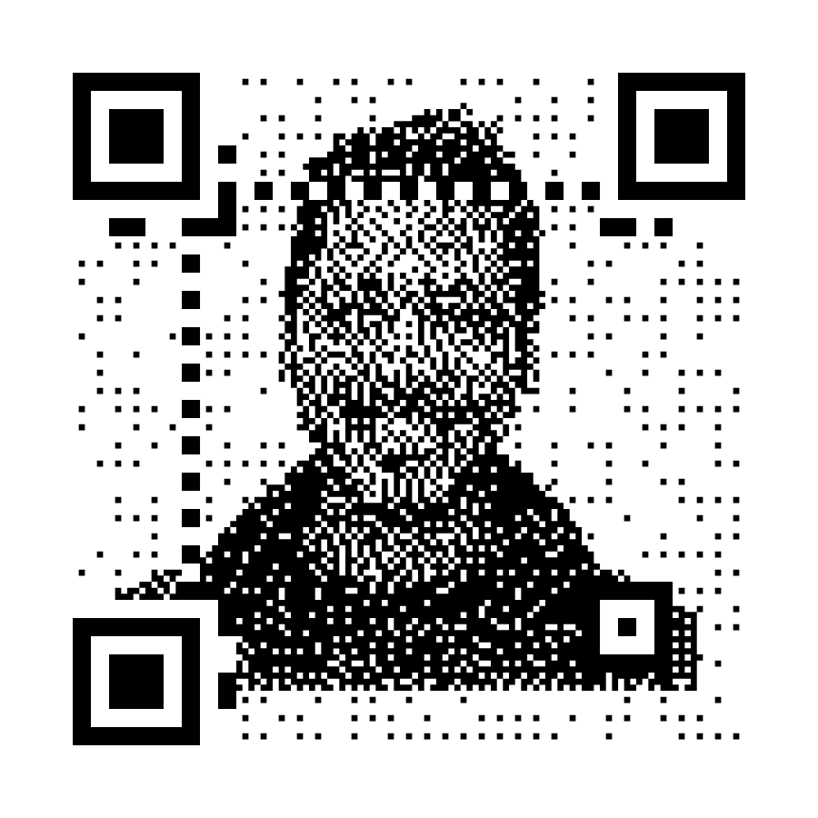
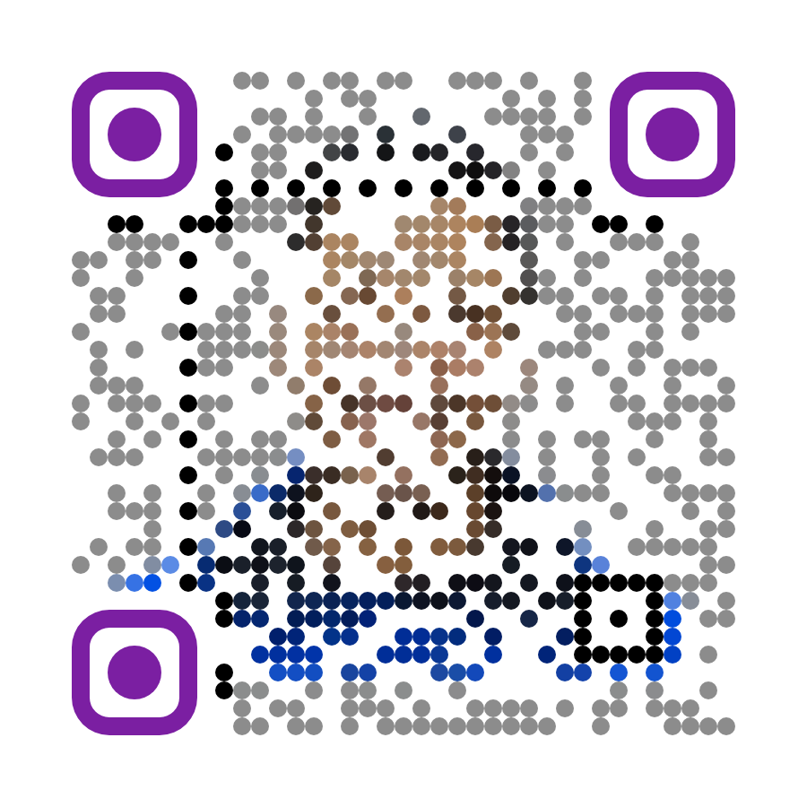
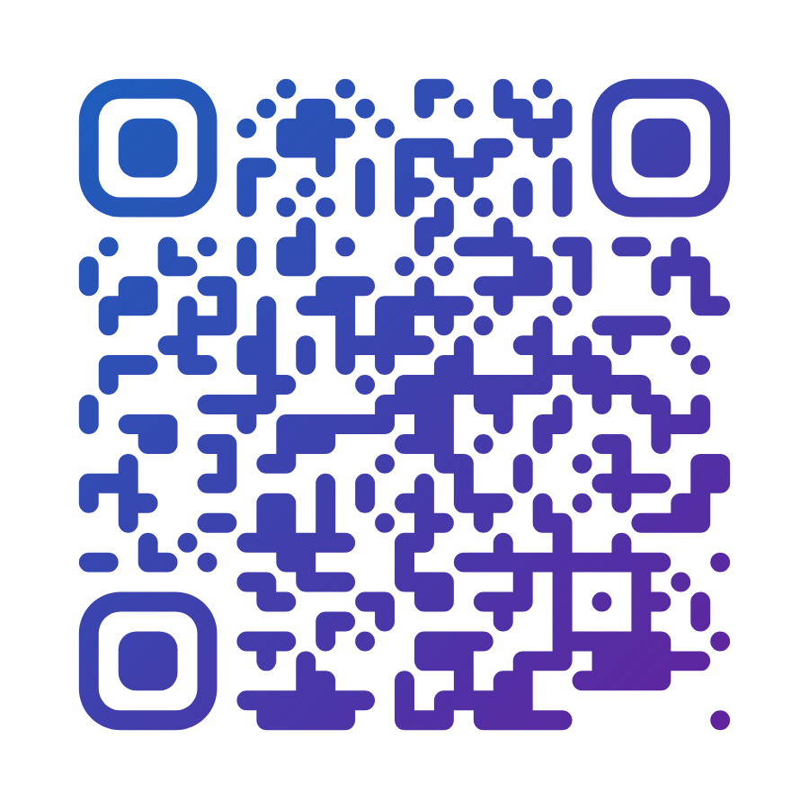

# artistic_qr

High-quality, fully customizable **artistic QR codes** for Flutter — custom
module & eye shapes, gradients, and three ways to weave an image into the
code itself: centered **logo**, color **blend**, and photo **halftone**
(the "face in the QR code" effect).

Ships with its **own ISO/IEC 18004 encoder** — zero runtime dependencies —
and every style is **decode-verified against zxing in the test suite**, so
pretty never means unscannable.

| Halftone photo | Color blend | Fluid gradient |
|---|---|---|
|  |  |  |

> Images above are actual package output (see `example/` for the full
> gallery; images visible on the repository, not on pub.dev).

## Features

* 📦 **Payload builders** — `QrData.wifi(...)`, `.vCard(...)`, `.whatsapp(...)`,
  `.email(...)`, `.sms(...)`, `.geo(...)`, `.event(...)` with correct escaping.
* 🏷 **Frames** — `QrFrame`: rounded border + "SCAN ME" banner, in the
  widget, PNG, and SVG exports alike.
* 🧊 **3D effects** — `QrEffect.extruded` (isometric blocks), `.shadow`
  (floating sticker), `.emboss` (bevel lighting).
* 🎞 **Animation** — `AnimatedArtisticQrCode` with gradient sweep, module
  reveal, and pulse effects (resting state always scans).
* 🎨 **Presets & JSON styles** — 8 curated `QrStylePresets`, and
  `QrStyle.toJson()/fromJson()` for saving and sharing designs.

* 🎨 **Module shapes** — square, circle, rounded, diamond, star, classy,
  neighbor-connected *fluid*, vertical/horizontal bars, or bring your own
  `ModuleShape.custom(...)`.
* 👁 **Eye styling** — square / rounded / circle / leaf frames & pupils,
  separate fills, and per-eye overrides.
* 🌈 **Fills** — solid colors or linear / radial / sweep gradients that flow
  across the whole symbol; adjustable dot size (`moduleScale`) and quiet zone.
* 🖼 **Image embedding** from **asset, file, network, or memory**:
  * `QrImageMode.logo` — centered logo, optional knockout, EC-aware size guard,
  * `QrImageMode.blend` — modules take the colors of the artwork beneath them,
  * `QrImageMode.halftone` — the photo is woven into the dots while every
    module's data-carrying center subpixel stays intact (dithering, colored
    or monochrome).
* 📤 **Exports** — Flutter widget, high-resolution PNG bytes (headless, no
  widget tree needed), and standalone **SVG** (true vector paths, gradients
  as `<defs>`, logo embedded as base64).
* 🛡 **Scannability guard** — contrast / quiet-zone / logo-size heuristics
  with debug warnings, and a test suite that renders every style and decodes
  it with a real QR reader.
* 🚀 **Zero runtime dependencies** — the QR encoder (Reed–Solomon, masking,
  all versions 1–40, UTF-8 via ECI) is implemented in pure Dart and verified
  bit-for-bit against zxing's encoder.

## Quick start

```dart
import 'package:artistic_qr/artistic_qr.dart';

ArtisticQrCode(
  data: 'https://example.com',
  size: 280,
  style: QrStyle(
    moduleShape: ModuleShape.circle,
    fill: QrFill.linearGradient(
      colors: [Color(0xFF1565C0), Color(0xFF6A1B9A)],
    ),
    eyeStyle: QrEyeStyle(
      frame: EyeFrameShape.rounded(),
      pupil: EyePupilShape.circle,
    ),
  ),
)
```

### Embed a logo

```dart
ArtisticQrCode(
  data: 'https://example.com',
  errorCorrection: QrErrorCorrection.high,
  image: QrImage(
    source: QrImageSource.asset('assets/logo.png'), // .file / .network / .memory
    mode: QrImageMode.logo(scale: 0.22, knockout: true),
  ),
)
```

### Halftone photo QR ("face in the code")

```dart
ArtisticQrCode(
  data: 'https://example.com',
  errorCorrection: QrErrorCorrection.high, // required headroom for art modes
  image: QrImage(
    source: QrImageSource.network('https://example.com/portrait.jpg'),
    mode: QrImageMode.halftone(dithering: true), // colored: true for color
  ),
)
```

### Color-blend artwork

```dart
ArtisticQrCode(
  data: 'https://example.com',
  errorCorrection: QrErrorCorrection.high,
  style: QrStyle(moduleShape: ModuleShape.circle),
  image: QrImage(
    source: QrImageSource.asset('assets/artwork.png'),
    mode: QrImageMode.blend(), // modules take the artwork's colors
  ),
)
```

### WiFi / vCard / WhatsApp payloads

```dart
ArtisticQrCode(data: QrData.wifi(ssid: 'CoffeeShop', password: 'espresso42'))
ArtisticQrCode(data: QrData.vCard(name: 'Dana Deaa', mobile: '+123456789'))
ArtisticQrCode(data: QrData.whatsapp(phone: '15550001111', text: 'Hi!'))
```

### Frames, 3D effects, presets, animation

```dart
// "SCAN ME" frame + curated preset:
ArtisticQrCode(
  data: url,
  style: QrStylePresets.ocean,
  frame: QrFrame(text: 'SCAN ME', color: Color(0xFF006064)),
)

// Isometric 3D blocks (or .shadow / .emboss):
ArtisticQrCode(
  data: url,
  style: QrStyle(moduleScale: 0.72, effect: QrEffect.extruded(depth: 0.4)),
)

// Animated (gradientSweep / reveal / pulse):
AnimatedArtisticQrCode(
  data: url,
  effect: QrAnimationEffect.gradientSweep,
  style: QrStylePresets.candy,
)

// Save & restore designs as JSON:
final json = jsonEncode(style.toJson());
final restored = QrStyle.fromJson(jsonDecode(json));
```

### Headless export (PNG / SVG)

```dart
final qr = await ArtisticQr.create(
  data: 'https://example.com',
  style: QrStyle(moduleShape: ModuleShape.fluid),
);

final Uint8List png = await qr.toPngBytes(pixelSize: 4096); // print-ready
final String svg = await qr.toSvg(size: 512);               // vector

// Design linting (also printed automatically in debug builds):
final warnings = qr.validate(); // e.g. low-contrast, logo-too-large…
```

## Scannability

Artistic styling always trades error-correction headroom for looks. The
package keeps you safe by default:

* Function patterns (finder eyes, timing, alignment) are never consumed by
  image modes; in halftone mode every module's **center subpixel** always
  carries the real data bit.
* `qr.validate()` flags low contrast, missing quiet zones, tiny dots, and
  logos too large for the chosen error-correction level — and prints these
  as warnings in debug builds.
* Use `QrErrorCorrection.high` with blend/halftone modes, and always test
  final printed designs with a couple of real phones.

## API overview

| Type | What it does |
|---|---|
| `ArtisticQrCode` | The widget: `data`, `style`, `frame`, `image`, `errorBuilder` |
| `AnimatedArtisticQrCode` | Animated variant: `gradientSweep`, `reveal`, `pulse` |
| `ArtisticQr` | Headless: `create` → `toPngBytes` / `toSvg` / `validate` |
| `QrData` | Payload builders: `wifi`, `vCard`, `email`, `sms`, `whatsapp`, `geo`, `event` |
| `QrStyle` | `moduleShape`, `moduleScale`, `fill`, `eyeStyle(+Overrides)`, `background`, `quietZone`, `effect` + `toJson`/`fromJson` |
| `QrStylePresets` | 8 curated decode-verified styles |
| `QrFrame` | Border + "SCAN ME" label banner |
| `QrEffect` | `extruded`, `shadow`, `emboss` 3D looks |
| `ModuleShape` | `square·circle·rounded·diamond·star·classy·fluid·bars·custom` |
| `EyeFrameShape` / `EyePupilShape` | `square·rounded·circle·leaf` |
| `QrFill` | `solid`, `linearGradient`, `radialGradient`, `sweepGradient` |
| `QrImageSource` | `asset`, `file`, `network`, `memory` |
| `QrImageMode` | `logo`, `blend`, `halftone` |
| `QrCode` | Low-level encoder access (role-tagged module matrix) |

## Example

The `example/` app is a gallery of ready-made styles — including
recreations of popular commercial QR-designer looks — plus all three image
modes and the headless exporters.

```sh
cd example && flutter run
```

## License

MIT
